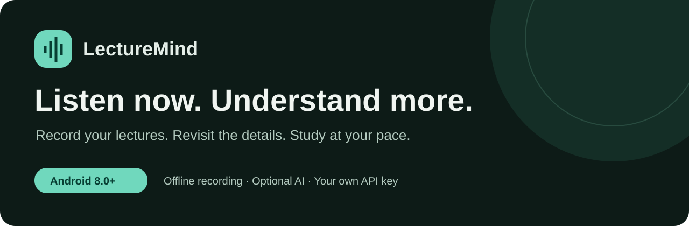
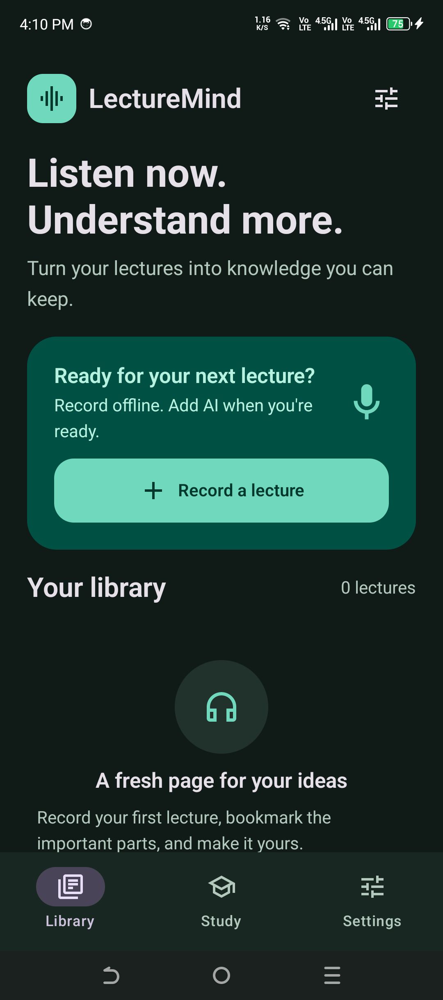
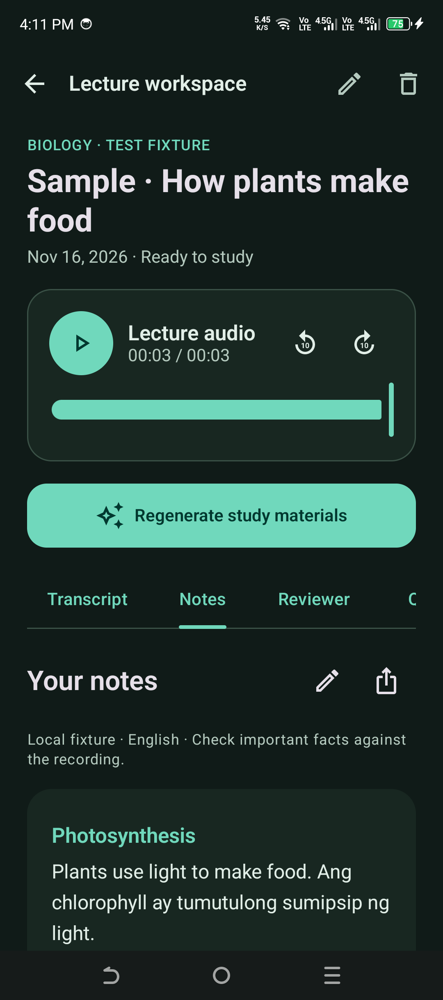
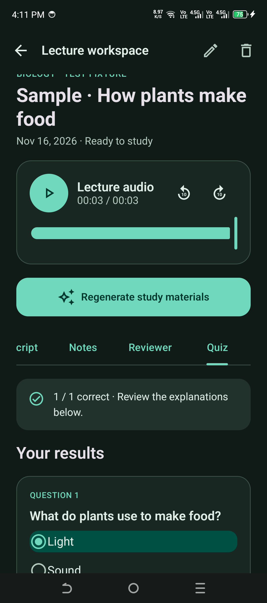

**Your lectures, ready to revisit. Your study time, better organized.**

Record offline, bookmark important moments, and use your own Gemini or OpenAI API key to create study materials.

Android 8.0+ · APK approximately 11.1 MB · Early access

## Download and install

**[Tap here to download LectureMind for Android](https://github.com/Gabbu69/LectureMind/releases/latest/download/LectureMind-1.0.0.apk)**

1. Open the download link on your Android phone. If Facebook's browser does not download the file, open the link in your phone's regular browser.
2. Open **Downloads** and tap **LectureMind-1.0.0.apk**.
3. If Android asks, allow **Install unknown apps** for the browser or file manager you used, then tap **Install**. You can switch that permission off afterward. Follow your device's security prompts; do not disable Play Protect.
4. Open **LectureMind** and grant microphone permission when you start your first recording.

No computer, GitHub account, or build tools are required. Choose the **.apk** file to install the app; GitHub's **Source code** ZIP files are for developers. This release is distributed directly through GitHub and is not on Google Play. An iPhone version is not available.

**Regional-language update:** transcription guidance and study-output choices now cover Ilonggo/Hiligaynon, Bisaya/Cebuano, Filipino/Tagalog and English. Gemini key authentication has been checked on a TECNO Android 14 phone; complete live study generation and native-speaker recognition accuracy remain unverified after provider failures. Recorded checks include 14 unit tests and six device tests. See the [verification report](VERIFICATION.md) for evidence and remaining acceptance work. The latest download points to the regional-language release; the original release is retained separately.

## From a lecture to a study session

| Capture | Revisit | Study |
| --- | --- | --- |
| Record without an internet connection | Play saved lecture audio | Generate a transcript, notes and reviewer with your own AI provider |
| Pause and resume recording | Jump back using bookmarks and source references | Practice with quizzes and answer explanations |
| Mark important moments as you listen | Edit notes in your lecture workspace | Export notes and reviewers as PDF or text |

### A look inside

  
  
  

Actual Android screenshots. Notes and quiz screens show a controlled local test fixture, not a live AI result. Screenshots may show the test build; the downloadable release uses the same application source.

## Your first lecture

1. **Ask permission to record.** Tap **Record a lecture**, add a title and subject, and confirm permission in the app.
2. **Capture the important parts.** Use **Mark important moment**, pause/resume as needed, and tap **Save** when finished.
3. **Set up AI when you want it.** In **Settings**, select Gemini or OpenAI, enter your own API key in the masked field, and tap **Save key**, then **Test connection**.
4. **Generate and review.** Open the saved lecture, choose **Generate study materials**, review the upload disclosure, choose 10/20/30 practice questions, and tap **Send & generate**. Short or insufficient lectures may produce fewer questions.
5. **Study at your pace.** Read/edit notes, use the reviewer, take a quiz, and share a PDF or text export.

Recording, playback and previously saved materials work offline. **AI generation requires internet, an API key and available provider quota; provider charges may apply.** A ChatGPT or Gemini app subscription does not supply an API key. Enter keys only inside the app, never in GitHub issues or messages.

Lecture input can include **Ilonggo/Hiligaynon, Bisaya/Cebuano, Tagalog/Filipino and English**, including mixed-language speech. Both provider adapters explicitly request the original spoken words, without converting local speech into Tagalog or English. Choose English, Filipino / Tagalog, Ilonggo (Hiligaynon), or Bisaya (Cebuano) for notes, reviewer and quiz output in Settings. These language instructions and text preservation are implemented; native-speaker recognition accuracy remains unverified. Check local words and generated content against the recording. OpenAI transcript references point to the start of each five-minute audio section rather than precise sentence timestamps.

## Privacy and storage

- Recordings and study materials stay in Android app-private storage unless you choose to export or send content to your selected AI provider. No LectureMind account, ads, analytics or LectureMind backend.
- Sending content for AI processing requires an in-app confirmation. Provider data policies and billing still apply.
- API keys use Android Keystore-backed encryption. Lecture audio uses Android's app sandbox/device encryption; it is not a separately encrypted vault.
- Audio uses roughly **115 MB per hour**. Keep enough free space before recording.
- **Export important content before uninstalling.** Uninstalling deletes your local library and saved keys. Shared exports remain separate files.

Read the [privacy notice](PRIVACY.md) for details.

## Updates and troubleshooting

Install a newer official APK over your existing app to keep local data, using the same signing identity. Export important notes first; an update retaining saved data is still awaiting physical acceptance. If installation fails, check Android 8.0+, free storage and that the APK downloaded completely. Do not uninstall to troubleshoot without exporting anything you need to keep.

AI errors usually require checking internet, your provider key, model access or quota. A successful connection test checks model access, not end-to-end transcription. If you find a bug, [open an issue](https://github.com/Gabbu69/LectureMind/issues/new/choose) with your phone model, Android version and steps to reproduce. Omit keys, private audio and personal lecture content.

## For developers

Native Kotlin / Jetpack Compose · Material 3 · Room · WorkManager · Media3 · OkHttp

- [Build instructions and toolchain](docs/BUILD.md)
- [Verification results and known limits](VERIFICATION.md)
- [Performance and storage notes](PERFORMANCE.md)
- [Release history](CHANGELOG.md)
- [Third-party Material icon notices](third_party/material-icons)

Source is provided for inspection. No general license for the original application code has been granted in this repository; bundled third-party components retain their own licenses.
